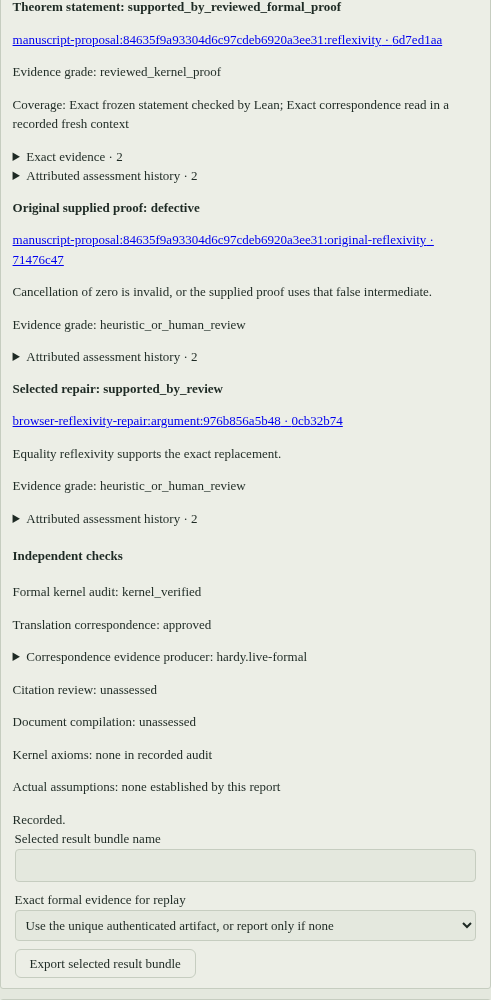

#  Hardy

[](https://github.com/charlesmsiegel/hardy/actions/workflows/tests.yml)
[](https://github.com/charlesmsiegel/hardy/actions/workflows/installers.yml)
[](https://github.com/charlesmsiegel/hardy/actions/workflows/cas-backends.yml)
[](LICENSE)

Hardy is an application for mathematical research, development, proof repair
and paper auditing, built around Lean 4 and a durable mathematical project.
Its workflows connect informal targets, definitions, representations,
prerequisites and supplied arguments to the evidence that supports them.
Versioned statements and contexts preserve what was actually asked; obligations
keep missing work visible; authenticated evidence separates a checked proof
from a translation judgment, an admitted premise or a compiled document.

The browser workbench and interactive session share project operations for
Research, Explore, Repair and Referee. The staged prover remains a direct entry
point for one theorem. Each surface records exact inputs, attempts, evidence and
outstanding work in the same durable project. See the
[roadmap](docs/roadmap.md) for validation and remaining work.

The name recalls G. H. Hardy's response to Ramanujan: recognize the insight,
then demand the proof.

## Work on a mathematical project

Suppose a manuscript states `1 = 1` but argues by cancelling zero, and another
result relies on an internal claim `0 = 1`. A useful audit has several answers
to give: whether each conclusion is established, whether the supplied argument
works, what happened to the internal claim, and whether a proposed repair fixes
the argument. Hardy keeps those assessments separate. An independent proof of
`1 = 1` does not repair its original argument; a refuted intermediate claim does
not automatically refute the theorem that cited it.

Start the browser workbench:

```sh
hardy web
```

Open or create a project through the registry. Files, the ledger graph, results
and publication views share the project's record. The Ledger controls let you:

- Create exact statements and mathematical contexts, including declarations,
  local hypotheses, notation and representation choices. Revisions retain old
  versions and require fresh evidence for changed inputs.
- Run **Research** on a selected target and scope, **Explore** a concept or
  representation, or **Repair** an exact defect and original argument. Proposals
  and missing prerequisites remain visible; a model response cannot close a
  proof obligation.
- Paste or select TeX sources and known audited-paper identities, propose source
  mappings, and review each mapping against its quoted source. Choose main results, required internal claims and citation
  depth before **Referee** runs its recorded layers.
- Review correspondence and premise admissions with the actual reviewer,
  conditions and reason. Admission requires exact source, search and Lean gates;
  required targets and novel manuscript results remain on the proof path.
- Inspect the theorem conclusion, original argument, intermediate claims and a
  selected repair independently, then export the selected result or Referee
  report. A result with retained formal evidence can include model-free Lean
  replay; unresolved assessments stay in the export.

For a first target, use the workbench composer or `hardy chat`:

```text
/project target Nonnegative "Every natural number is nonnegative" --formal "lemma nonnegative (n : Nat) : 0 ≤ n"
```

This creates separate informal/formal proposals and an empty-premise scope.
Review their correspondence side by side. Save the exact statement and proof
through Files, then select its checked result under **Bind checked save**.
Research can also prepare and prove the selected target through the controlled
save path. The command equivalents and exact-version syntax are in
[session commands](docs/reference/session-commands.md); [getting started](docs/getting-started.md)
walks through both routes.

<details>
<summary>A conclusion, defective original and separate repair</summary>



Actual served workbench, controlled reflexivity fixture: pinned Lean/Mathlib
checked the conclusion; the original zero-cancellation argument remains
defective, and the selected replacement has heuristic review support.
Model responses and review judgments were scripted synthetic inputs; no provider
model was invoked. Document compilation and citation review remain unassessed.

</details>

The [project workflow fixtures](tests/unit/test_live_project_workflows.py),
[manuscript fixtures](tests/unit/test_live_manuscript.py) and
[standalone replay tests](tests/unit/test_standalone_replay.py) make the
controlled input/output checks inspectable.

Kernel proof, statement correspondence, scoped assumptions, citation review and
document compilation carry independent evidence. A checked Lean proof
establishes its exact formal statement under the axioms it used; connecting it
to the intended mathematics still needs correspondence and hypothesis review.
A model or human argument assessment carries its own evidence level and actual
conditions. Workflow proofs use ordinary lemma saves and appear as semantic
results in Ledger, workflow reports and selected bundles. The Results/theorem
writeup registry retains its separate explicit naming, theorem and document
gates. Compiling a report supplies no theorem support.

The records survive restart, including failed and interrupted attempts. Resume a
workflow with its original request ID and unchanged mathematical inputs; changed
inputs require a new request. Stop cancels active work and preserves its history.
Changes to a source, context, definition, citation or proof dependency withdraw
affected current acceptance while retaining the historical record.

## Prove one theorem

A recorded staged proof, from a claim in ordinary language to a kernel-checked Lean
file and a compiled writeup:

```sh
hardy prove "The real number sqrt(2) + sqrt(3) is irrational."
```

Hardy freezes a formalization of the claim under a hash, has an independent
reader confirm that the Lean statement and the English claim entail each
other, and only then lets the model search for a proof. The recorded run
under `acceptance/recorded/prove-verified/` contains this Lean file (excerpt; omitted proof steps are shown as `...`):

```lean
import Mathlib

theorem irrational_sqrt_two_add_sqrt_three : Irrational (Real.sqrt 2 + Real.sqrt 3) :=
by
  rintro ⟨q, hq⟩
  have hs2 : Real.sqrt 2 ^ 2 = 2 := Real.sq_sqrt (by norm_num)
  have hs3 : Real.sqrt 3 ^ 2 = 3 := Real.sq_sqrt (by norm_num)
  ...
  refine irrational_sqrt_two ⟨(q ^ 2 - 1) / (2 * q), ?_⟩
  ...

#print axioms irrational_sqrt_two_add_sqrt_three
```

and with these grades in its `manifest.json`:

```json
"grades": {
  "formal": "kernel_verified",
  "faithfulness": "user_approved",
  "document": "tex_compiled",
  "verification_evidence": {
    "axioms": ["propext", "Classical.choice", "Quot.sound"],
    "toolchain": {"lean_version": "4.35.0-rc3", "mathlib_revision": "5e0c4e52..."}
  }
}
```

The formal grade comes from the kernel's own `#print axioms` report, not from
an exit code, and the manifest hashes every file it describes. Anyone can
recheck the recorded run without a model:

```sh
hardy accept --recorded acceptance/recorded/prove-verified/20260901T220742+0000-sqrt-two-plus-sqrt-three-irrational-8ccb35a8
```

## How it keeps itself honest

- **The kernel is the only authority.** A proof is verified when Lean's kernel
  accepts it and the parsed `#print axioms` report contains nothing beyond the
  standard axioms. `sorryAx` is a hole no approval can convert; an unapproved
  axiom is a rejection. See [the output contract](docs/design/output-contract.md).
- **The statement is frozen before proving.** The formalization is hashed, and
  every proof check is against that exact statement; a proof of something else
  is not a proof. The hash travels in
  [the run's manifest](docs/reference/artifacts.md).
- **An independent reader checks the formalization.** Before any proof search,
  a reader with no tools, given only the user's words and the frozen Lean
  signature, must agree that each entails the other. That faithfulness check is
  the one gate that decides whether the proof is about the claim. On the
  default Claude backend the reader is offered no tools and cannot read the
  filesystem; under `--backend codex` that isolation cannot be enforced (the
  reader can read anywhere the SDK's sandbox allows), and the verdict records
  what its isolation was actually worth rather than claiming otherwise. See
  [the trust boundary](docs/design/trust-boundary.md).
- **Hardy runs every tool, and admits assumptions rather than accepting
  them.** The model decides when a Lean check, a search, a computer-algebra
  cell, or a LaTeX compile happens; Hardy's own code runs it and writes every
  record, and on the Claude backend the SDK's own tools are refused by a
  default-deny gate. An axiom the model wants is searched for first,
  elaborated, probed for triviality and vacuity, and for a counterexample
  where the axiom comes from a paper or a staged `--assume` file, and shown
  to a human beside the session's stated goal; declining is the default. See
  [what Hardy controls](docs/design/trust-boundary.md#what-hardy-controls-and-what-it-does-not).
- **The document cannot outrun the proof.** The compiled writeup carries a
  provenance banner computed from the record, and a theorem stated in the
  writeup without a kernel-checked counterpart blocks the report. Saying it in
  prose instead does get past the theorem gate, as does a `lemma` environment;
  the banner's counts are what cover that, and they count rather than point.
  See [what the document must carry](docs/design/output-contract.md).

## What this cannot establish

The axiom audit is elaborated by an environment the audited source could have
extended. Hardy reports what Lean's kernel says a theorem depends on, but that
report is produced inside a system the theorem's own source could have
modified. Closing the gap needs an independent, sandboxed re-check that Hardy
does not yet do; [the trust boundary](docs/design/trust-boundary.md) carries
the full argument. Nothing here confines the Lean, LaTeX, or computer-algebra
processes it runs; treat the machine as disposable and read
[running Hardy safely](docs/guides/running-safely.md) before running it on one
you care about.

## Install

From a clone, on Linux or macOS:

```sh
git clone https://github.com/charlesmsiegel/hardy.git
cd hardy
scripts/install.sh
claude login
hardy doctor
```

On Windows, without WSL:

```powershell
powershell -ExecutionPolicy Bypass -File scripts\install-windows.ps1
```

The installer brings up Python, elan and Lake, pinned Mathlib and Tectonic,
interactive LaTeX tools, the Claude Code CLI and Hardy itself, reusing healthy
existing tools; expect the Mathlib step to take a while. The default `claude`
backend uses Claude Code subscription sign-in;
`claude auth status` must report a logged-in account. The optional `api` backend
needs the `api` extra, an explicit backend setting and `ANTHROPIC_API_KEY`.
Interactive sessions accept `claude` or `api`; the optional Codex backend is a
staged `prove`/`accept` flag. Configuration and authentication are described in
[the settings reference](docs/reference/configuration.md). Once a release is
tagged, a one-line installer will fetch the released wheel instead of a clone. [The install guide](docs/install.md)
covers every option, path, and failure mode.

## Use

| Command | What it does |
| --- | --- |
| `hardy`, `hardy chat` | Open or resume a durable mathematical project, with project workflows, Lean, LaTeX and computer algebra. |
| `hardy web` | Serve the browser client on 127.0.0.1; it opens projects from its own registry, never the current directory. |
| `hardy prove` | Take one claim from statement to verified document, staged and gated. |
| `hardy doctor` | Check tool, configuration and selected-backend authentication prerequisites. |
| `hardy setup` | Discover, install, and record the pinned toolchain. |
| `hardy accept` | Run the checked-in acceptance problems, or recheck recorded runs. |
| `hardy batch` | Run one proof request unattended and record the trajectory. |
| `hardy evals` | Sweep, run, check, pool, and compare a fixed corpus of statements. |
| `hardy latency` | Measure the Lean import cost a warm process pool would recover. |

Start with [getting started](docs/getting-started.md), then the guides to
[the interactive session](docs/guides/interactive-session.md),
[proving](docs/guides/proving.md), and
[evaluation](docs/guides/evaluation.md). Every command and flag is in
[the command reference](docs/reference/cli.md).

## Current scope

The interactive session, the staged prove workflow, batch runs, and the
evaluation harness all work against a real Mathlib installation, and four
recorded acceptance runs are rechecked without a model in CI. The corpus
holds twenty classified statements, five of them deliberately false twins.
The Schottky counting, Riemann–Roch and EGH trials remain planned mathematical
acceptance work; engineering checks do not establish their conclusions.
There are no benchmark numbers: no controlled measurement of what the harness
contributes over a bare model has been run yet, and the pages here describe
mechanism rather than performance. Execution is not confined. Planned work
and its dependency order live in [the roadmap](docs/roadmap.md).

## Architecture

```text
src/hardy/
  app/          CLI, TUI, MCP server, configuration and machine setup
  workflows/    interactive sessions, staged proving, batch runs and the ledger
  agents/       provider adapters, conversation events, loops and usage
  formal/       Lean syntax, builds, retrieval, axiom policy and verification
  documents/    TeX checks, compilation, writeups and exports
  algebra/      CAS backends, kernels, sessions, replay and exports
  literature/   paper acquisition, archives, inventory and bibliography
  corpus/       statement schema, taxonomy, content identity and releases
  evals/        sweeps, run selection, scoring, validation and pooling
  foundation/   strict values, guarded files, paths, locks and processes
  prompts/      prompt rendering and packaged templates
```

Dependencies point one way, from `app` through `workflows` to the capability
packages and down to `foundation`, and a test enforces it. The
[architecture overview](docs/design/overview.md) has the diagrams; the
[design pages](docs/design/) carry the reasoning, and the
[decision record](docs/design/decisions.md) says what was chosen over what.

## Engineering

Each row names a check and the workflow or test that runs it, with when it
runs.

| Check | Runs | Where |
| --- | --- | --- |
| The hermetic suite, with a coverage floor that fails the build | every push to `main` and every pull request | `.github/workflows/tests.yml`, `pyproject.toml` |
| A real Lean axiom audit against the current stable toolchain, left unpinned on purpose so a toolchain change shows up | every push to `main` and every pull request | `.github/workflows/tests.yml` |
| Singular and Macaulay2 kernels at pinned package versions | pushes to `main`, and pull requests that touch `src/hardy/**`, the CAS tests, or the workflow itself | `.github/workflows/cas-backends.yml` |
| The installers, on Linux, macOS, and Windows runners, verifying the built release assets against `SHA256SUMS` | every push to `main` and every pull request | `.github/workflows/installers.yml` |
| The corpus manifest digest, anchored against the merge base so a shard edit cannot rewrite its own digest | every pull request | `.github/workflows/tests.yml` |
| Four recorded acceptance runs rechecked without a model | inside the hermetic suite | `tests/integration/test_recorded_acceptance.py` |
| Reference documentation checked against the parser, the command registry, and the settings table | inside the hermetic suite | `tests/unit/test_docs.py` |
| Release assets published with a `SHA256SUMS`, and a release that already has assets is never rewritten | on a version tag | `.github/workflows/release.yml` |

## Documentation

[The documentation map](docs/README.md) lists every page. The ones most people
want first:

- [Getting started](docs/getting-started.md)
- [Command reference](docs/reference/cli.md)
- [Session commands](docs/reference/session-commands.md)
- [Configuration](docs/reference/configuration.md)
- [Trust boundary](docs/design/trust-boundary.md)
- [Running Hardy safely](docs/guides/running-safely.md)

Contributors should read [CONTRIBUTING.md](CONTRIBUTING.md); agents read
[AGENTS.md](AGENTS.md).

## Related

These share a commitment: a system should not be able to assert more than its
artifacts support.

- [ludex-rpg](https://github.com/charlesmsiegel/ludex-rpg): a quote and a
  paraphrase must never be confusable, anywhere in the app.
- [coding-skills](https://github.com/charlesmsiegel/coding-skills): a finding
  asserts a defect and carries a fix; a candidate reports a lead and carries
  the benign explanations. Confusing them raises.
- [grimoire](https://github.com/charlesmsiegel/grimoire): the prompt a reply
  came from stays readable after everything it drew on has moved.
- [rpg-bookbinder](https://github.com/charlesmsiegel/rpg-bookbinder): state
  lives in files, not in a shared prompt.

## License

[Apache-2.0](LICENSE). The corpus under `corpus/` is
[CC-BY-4.0](corpus/LICENSE).

Built by [Charles Siegel](https://github.com/charlesmsiegel).
