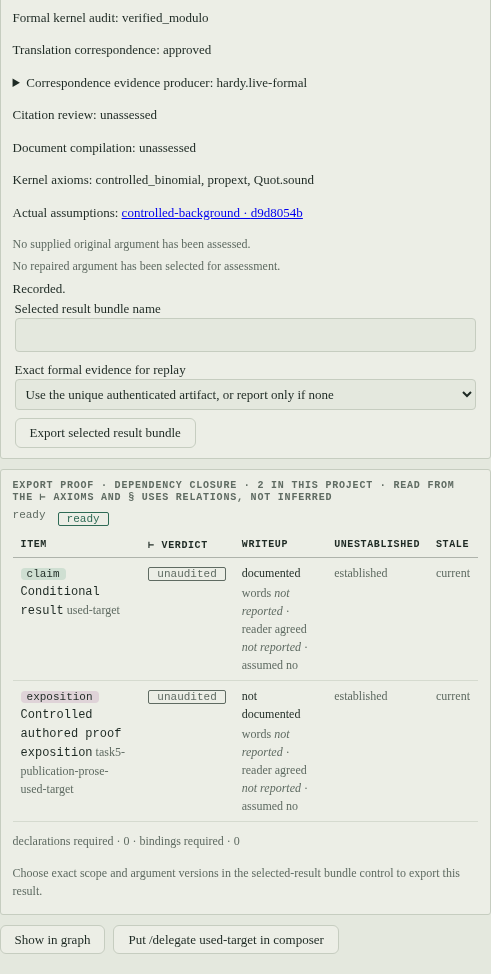

# Getting started

Install Hardy, open a mathematical project, and keep statement correspondence,
kernel proof and supplied-argument review separate. The browser workbench and
`hardy chat` call the same project operations.

## 1. Install and authenticate

From a clone on Linux or macOS:

```sh
git clone https://github.com/charlesmsiegel/hardy
cd hardy
scripts/install.sh
claude login
claude auth status
hardy doctor
```

On Windows, run `scripts\install-windows.ps1` with PowerShell, as described in
[Installing Hardy](install.md). The installer installs this checkout editable,
so keep it in place. It provisions Python, Lean/Lake, pinned Mathlib and
Tectonic, interactive LaTeX tools and the Claude Code CLI, reusing healthy
existing tools. Options such as `--skip-mathlib` and `--skip-latex` deliberately
leave those capabilities unavailable.

The default `claude` backend uses your Claude Code subscription. Authentication
is successful when `claude auth status` reports `loggedIn: true`; an installed
CLI or its version number does not establish sign-in. There is no separate Hardy
account.

For the optional API transport, install `hardy-prover[api]`, set
`backend = "api"` in `~/.hardy/config.toml` and supply `ANTHROPIC_API_KEY` in the
environment. Choose the actual model identity your endpoint supports. The API
transport is metered separately from a subscription. Interactive `backend`
accepts `claude`, `api`, `openai` or `openrouter`; the latter two use the optional
`openai` extra, an explicit model and their API key (see the
[configuration reference](reference/configuration.md#openai-compatible-endpoints-and-openrouter)). Codex requires the optional `codex` extra and is a
`--backend codex` choice on staged `prove`/`accept`. See
[Configuration](reference/configuration.md) for settings, precedence and
backend-specific authentication.

`hardy doctor` reports executable, configuration and authentication checks and
exits `1` when a required check fails. `hardy doctor --deep` also elaborates a
small Mathlib example. Compiler version checks do not establish that a complete
document will compile: interactive tools use `latex_command`, normally
pdflatex, while staged documents use Tectonic and need its TeX bundle. Read the
named failing check before starting a long run.

## 2. Open a project in the workbench

```sh
hardy web
```

Open the printed loopback URL, then create a project or add an existing Hardy
problem directory through the registry. The browser uses its registry rather
than the shell's current directory. Files, Ledger, Results and Publication read
the selected project's durable record. Closing the browser does not stop the
server; Ctrl+C in its terminal does.

In the composer, record a small target:

```text
/project target Nonnegative "Every natural number is nonnegative" --formal "lemma nonnegative (n : Nat) : 0 ≤ n"
```

This records two exact proposals, their scope and separate open translation and
proof obligations. It does not run Lean. In Ledger, inspect the informal and
formal statements together and record an approved, disputed or unresolved
correspondence judgment. Enter your reviewer label, what you actually examined,
and your reason; an approval is a correspondence record, not a kernel proof.

In Files, save a Lean file containing:

```lean
import Mathlib

lemma nonnegative (n : Nat) : 0 ≤ n := Nat.zero_le n
```

The editor uses the checked-save and axiom-audit path. In Ledger, select
`nonnegative` under **Checked result**, then **Bind checked save**. Inspect the
separate formal-proof and correspondence fields. An approved current translation
and exact bound checked proof support this statement; any supplied original
argument still needs its own assessment. This lemma and live workflow results are
inspected in Ledger/workflow reports and bundles. The native Results/theorem
writeup registry remains a separate lane with its ordinary intentional naming,
theorem and document gates.

Export the snapshot with the Ledger control or composer:

```text
/project inspect Nonnegative
/project export Nonnegative --output nonnegative-review
```

The snapshot is `reports/nonnegative-review.json`. Existing output names are
refused. Reopen the same project to recover the same target and evidence. After
changing Lean source or build inputs, check and save again, then bind the new
exact result. A target correction uses a new ID and the current exact reference
with `--supersedes`; old evidence remains historical.

Publication authenticates proof authority for the exact selected item. For
this native checked-save/bind slice, select `Nonnegative:formal` under
`Nonnegative:scope`; `Nonnegative` has correspondence support. Its target report
can say `supported_by_reviewed_formal_proof` while publishing that informal item
still leaves an unresolved draft. The formalization link does not automatically
transport proof or premise authorization. Publication also needs appropriate
linked exposition and document checks; PDF compilation and native Results
registration remain separate. See
[publication commands](reference/cli.md#project-publication-commands).

## 3. Research, Explore and Repair

In **Research, Explore and Repair**, inspect the capability reasons before
starting. Each operation records a run ID, exact request, attempts, elapsed time,
actual model/backend and prompts, tool evidence and reported usage. Missing
usage stays unknown; a missing provider or capability produces explicit
blocked/pending work.

- For **Research**, select `Nonnegative`, its required scope, and **Prove**.
  Hardy identifies and classifies prerequisites, prepares the exact statement,
  checks correspondence and uses the controlled Lean save path. Human
  correspondence concerns and missing prerequisite evidence remain gates.
- For **Explore**, select context, concept or representation, describe the
  intended mathematics, and select the relevant exact context/use site.
  Structured proposals remain proposals until their semantic obligations are
  reviewed.
- For **Repair**, select an outstanding defect obligation and its exact original
  supplied argument. A proposed replacement has a distinct argument version,
  replacement steps and affected graph. Inspect that repair separately from the
  original; proving the conclusion alone does not assess every replacement step.

Use **Stop active workflow** or Escape to cancel. History retains unfinished
work. To resume, submit the same run ID with unchanged mathematical request;
reusing the ID for different inputs is refused. **Obligations · work and
history** includes open, investigating and blocked work and lets you select
resolved, dismissed and abandoned history.

<details>
<summary>Read an explicitly conditional proof</summary>



Actual served workbench, controlled fixture: pinned Lean/Mathlib checked a proof
using the admitted `controlled_binomial` premise. The report names that actual
use; an allowed unused premise is a separate case. Model/review inputs were
scripted synthetic fixtures, with no provider invoked. Project publication
readiness, native audit display and document compilation remain separate.

</details>

Before repairing an argument you enter yourself, open **Record supplied
arguments, steps, critiques and revisions**. Record the original text against
its exact conclusion; leave **Original argument being repaired** empty. Add
source-bound proof steps and internal claims with their containing argument and
actual dependencies. A source region uses Unicode character offsets in the
retained text. Intake can create these records from reviewed manuscript
mappings instead. Inspect the exact outstanding critique/check obligation before
selecting Repair; an arbitrary conclusion-proof obligation is not a supplied
argument defect.

The same operations are available in the composer or terminal. Read exact
target/scope/argument references from the catalog rather than typing a short
digest. [Session commands](reference/session-commands.md#project) gives the
command forms and structured request fields.

## 4. Intake and referee a manuscript

Under **Import manuscript and propose source mappings**, select an exact saved
TeX source or use **Paste manuscript TeX** to retain the text. Give the intake a
run ID and new scope ID. Select all source files required by the manuscript,
and enter its exact canonical paper identity/version when known under **Target
paper identities and versions**. This keeps sources from the paper being audited
on the required proof path. Choose citation depth 0, 1 or 2, then **Propose
manuscript mappings**.

In **Review manuscript mappings and required results**, select the exact
proposal. Read each quote in its source span; approve, dispute or leave its
mapping unresolved with a reason. Choose the main results and required internal
claims. Unmapped text, unsupported constructs and ambiguous mappings remain
visible. Selecting previously admitted background cannot admit a new premise;
required and novel manuscript claims remain protected.

Then open **Referee · main results, supplied arguments and repairs** and select
the exact reviewed manuscript mapping. Its scope, ordered main/internal results
and citation depth are shown read-only. Choose the original/repair versions to
assess, bound citation nodes to between 1 and 128, then **Run Referee**. To change
result roles or citation depth, record a new intake/review. The report states which semantic, structural, adversarial and citation layers
actually ran, which were skipped/blocked, and their conditions. A citation
mention, source retrieval, theorem identification and hypothesis applicability
are distinct checks.

For example, a manuscript can have a true `1 = 1` conclusion with an invalid
zero-cancellation argument. A checked reflexivity proof supports the conclusion;
the original argument can remain defective. A refuted internal claim can break
a supplied argument while leaving its main conclusion unresolved. Read the
separate theorem, original-proof, intermediate-claim and selected-repair
assessments rather than deriving one from another.

Under **Select argument versions, report and reproducible export**, choose the
exact scope and arguments, inspect their assessments, and export a selected
result bundle. If several proof artifacts are current, choose the exact formal
evidence for replay; an ambiguous selection is refused. Retained checked Lean
evidence can supply standalone model-free
replay; without the exact artifact and dependency closure, the bundle explains
why replay is unavailable. The Referee report history also exports an exact
source-mapped report. Bundles live at `reports/NAME.bundle/` and contain
`report.json`, a file-hash manifest and retained provenance. These differ from
the JSON snapshot above.

When `report.json` says replay is `ready`, follow `replay/README.txt`. Prepare
the recorded Lean/Lake release and pinned project/dependencies, then run the
bundle's exact command from its `replay/` directory:

```sh
python3 -I replay.py --project /absolute/pinned-project --lake /absolute/toolchain/bin/lake --lean /absolute/toolchain/bin/lean --manifest-sha256 FULL_REPLAY_MANIFEST_SHA256
```

Replace the paths and digest with the exact values in that bundle. The runner
uses Python's standard library, needs no Hardy package/provider credentials,
checks source/environment identities and performs a fresh named axiom audit.
Dependencies are not bundled. The runner also pins the configured project's
whole root Lean-source inventory: unrelated custom root files outside the
selected retained closure must be supplied separately with their original bytes
at the recorded paths. Missing material is refused, so a bundle alone cannot
reconstruct an arbitrary custom project. Dependency source and compiled-library inventories
must match; a rebuilt cache with different bytes is refused even at the same
source revision. The compiled dependency hashes are captured at export and do
not independently establish their derivation from source. Replay runs Lean in
that configured environment; the existing execution/audit trust boundary still
applies. The fresh result does not restamp historical evidence or establish
translation or argument correspondence.

## 5. Prove one theorem or inspect a recording

The staged entry point handles a single claim:

```sh
hardy prove "The real number sqrt(2) + sqrt(3) is irrational."
```

It asks you to approve or revise a formalization, freezes that claim, obtains a
separate correspondence read, searches for a proof, verifies it and builds a
writeup. Read its independent grades rather than its exit code alone. See
[Proving a claim](guides/proving.md) for declared assumptions, backend options
and stage limits.

Inspect the checked-in recording without a provider, Lean build or network:

```sh
hardy accept --recorded acceptance/recorded/prove-verified/20260901T220742+0000-sqrt-two-plus-sqrt-three-irrational-8ccb35a8
```

This checks consistency among the retained manifest, trajectory and artifacts.
It does not execute a fresh Lean proof; standalone selected-result replay is
the separate operation described above. The README's Lean excerpt comes from
this recording and omits proof steps explicitly.

## Where to go next

- [Interactive session](guides/interactive-session.md) and
  [session commands](reference/session-commands.md) for project operations.
- [Installing Hardy](install.md), [configuration](reference/configuration.md)
  and [CLI reference](reference/cli.md) for machine and launch settings.
- [Artifacts](reference/artifacts.md) and [on-disk layout](reference/on-disk-layout.md)
  for exact evidence and retained files.
- [Trust boundary](design/trust-boundary.md) and
  [running safely](guides/running-safely.md) for execution and evidence limits.
- [Roadmap](roadmap.md#application-integration-of-semantic-workflows) for
  validation, unavailable checks and the planned mathematical trials.
